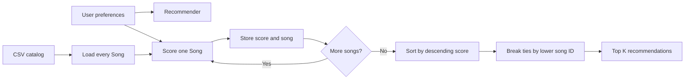

# 🎵 Music Recommender Simulation

## Project Summary

In this project you will build and explain a small music recommender system.

Your goal is to:

- Represent songs and a user "taste profile" as data
- Design a scoring rule that turns that data into recommendations
- Evaluate what your system gets right and wrong
- Reflect on how this mirrors real world AI recommenders

Replace this paragraph with your own summary of what your version does.

---

## How The System Works

Real-world music recommenders estimate how likely a listener is to enjoy a song from patterns in listening history, similarity to other users and songs, and the song's metadata or audio features. Our simulation will be simpler and will prioritize transparent, content-based matching: it will compare each song directly with an explicit taste profile and rank the closest matches.

**Object features**

- `Song`: `id`, `title`, `artist`, `genre`, `mood`, `energy`, `tempo_bpm`, `valence`, `danceability`, and `acousticness`.
- `UserProfile`: `favorite_genre`, `favorite_mood`, `target_energy`, and `likes_acoustic`.

**Example taste profile**

```python
user_prefs = {
    "genre": "pop",
    "mood": "happy",
    "energy": 0.68,
    "likes_acoustic": False,
}
```

This profile represents a listener who enjoys pop, especially happy music, prefers a moderate-to-lively energy level, and does not prefer strongly acoustic arrangements. It is specific enough to distinguish quiet chill/lofi and aggressive rock from the user's taste, while the middle energy target (rather than an extreme `1.0`) allows several styles and energy levels to remain eligible. The functional dictionary keys correspond to the `UserProfile` fields: `favorite_genre`, `favorite_mood`, `target_energy`, and `likes_acoustic`.

**Scoring rule**

### Finalized Algorithm Recipe



The flow begins with the user's preferences and the complete CSV catalog. For each individual song, the recommender compares genre, mood, energy, and acousticness with the profile, calculates the total score, and stores that score with the song. After every catalog row has been evaluated, the results are sorted by descending score; a lower song ID breaks ties, and only the first `k` songs are returned.

The recommender will give every catalog song the following four-part score. Exact genre and mood matches provide meaningful bonuses, while energy and acousticness add smaller continuous or directional adjustments:

- **Genre match: +2.0 points** when `song.genre` equals `user.favorite_genre`.
- **Mood match: +1.0 point** when `song.mood` equals `user.favorite_mood`.
- **Energy similarity: up to +1.5 points**, calculated from closeness to `user.target_energy`:
  `energy_points = 1.5 × (1 - |song.energy - user.target_energy|)`
- **Acoustic preference: +0.5 points** when the acousticness direction agrees with `user.likes_acoustic`:
  +0.5 if the user likes acoustic and `song.acousticness >= 0.50`, or if the user does not like acoustic and `song.acousticness < 0.50`.

The maximum score is 5.0. The complete formula is:

`total_score = genre_points + mood_points + energy_points + acoustic_points`

Genre is weighted highest because matching the broad listening category is a strong signal. Mood is worth half a genre match, providing an important but less dominant preference. Energy contributes up to 1.5 points and rewards similar values continuously; for example, target energy `0.68` gives a `0.82`-energy song `1.5 × (1 - 0.14) = 1.29` points. Acoustic preference is a 0.5-point tie-breaker rather than a major category. These weights may be tuned later, but this is the starting recipe.

The recommender will calculate the score for every song, sort by descending `total_score`, and return the top `k` songs. If scores tie, songs may be ordered by lower `id` as a deterministic tie-breaker. For example, a pop/happy song with 0.82 energy and 0.18 acousticness can earn 2.0 genre + 1.0 mood + about 1.29 energy + 0.5 acoustic = 4.79 points, while a lofi/chill song receives only its energy and potentially its acoustic points.

The fields `tempo_bpm`, `valence`, and `danceability` remain available for future scoring and explanations, but are not part of this finalized starting recipe.

**Potential biases**

- The genre bonus is the largest match bonus, so the system may over-prioritize the favorite genre and miss strong cross-genre songs that match the user's mood or energy.
- Mood is treated as a single exact label; a song with a related mood may receive no mood points even when it could suit the user.
- The acousticness threshold is a rough binary split that may not represent preferences in the middle of the `0.0–1.0` range.
- A fixed `0.68` energy target and the catalog's limited genre coverage may make recommendations narrow or favor whichever styles are most represented.

---

## Getting Started

### Setup

1. Create a virtual environment (optional but recommended):

   ```bash
   python -m venv .venv
   source .venv/bin/activate      # Mac or Linux
   .venv\Scripts\activate         # Windows

2. Install dependencies

```bash
pip install -r requirements.txt
```

3. Run the app:

```bash
python -m src.main
```

### Running Tests

Run the starter tests with:

```bash
pytest
```

You can add more tests in `tests/test_recommender.py`.

---

## Sample Recommendation Output

```text
Loaded songs: 18

User Profile:
  Genre: pop | Mood: happy | Energy: 0.68 | Likes acoustic: False

Top 5 Recommendations:

1. Sunrise City by Neon Echo
   Score: 4.79
   Reasons: genre match (+2.0); mood match (+1.0); energy similarity (+1.29); acoustic preference (+0.5)

2. Gym Hero by Max Pulse
   Score: 3.62
   Reasons: genre match (+2.0); energy similarity (+1.12); acoustic preference (+0.5)

3. Rooftop Lights by Indigo Parade
   Score: 2.88
   Reasons: mood match (+1.0); energy similarity (+1.38); acoustic preference (+0.5)

4. Island Letters by Saint Current
   Score: 1.99
   Reasons: energy similarity (+1.49); acoustic preference (+0.5)

5. Night Drive Loop by Neon Echo
   Score: 1.90
   Reasons: energy similarity (+1.40); acoustic preference (+0.5)
```

**Screenshot or video** *(optional)*: <!-- Insert a screenshot or demo video link here -->

---

## Experiments You Tried

Use this section to document the experiments you ran. For example:

- What happened when you changed the weight on genre from 2.0 to 0.5
- What happened when you added tempo or valence to the score
- How did your system behave for different types of users

---

## Limitations and Risks

Summarize some limitations of your recommender.

Examples:

- It only works on a tiny catalog
- It does not understand lyrics or language
- It might over favor one genre or mood

You will go deeper on this in your model card.

---

## Reflection

Read and complete `model_card.md`:

[**Model Card**](model_card.md)

Write 1 to 2 paragraphs here about what you learned:

- about how recommenders turn data into predictions
- about where bias or unfairness could show up in systems like this
