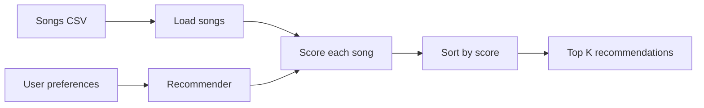

# Music Recommender Simulation

## Project Summary

This project builds a small CLI-first music recommender. It represents songs and user taste as data, scores each song with a weighted rule, and ranks the closest matches.

---

## How The System Works

Real music recommenders use listening history and song features such as genre, mood, tempo, and energy to estimate what a user may enjoy. This simulation uses explicit user preferences instead of a trained model:

- Each `Song` uses `genre`, `mood`, `energy`, `tempo_bpm`, `valence`, `danceability`, and `acousticness`.
- Each `UserProfile` stores `favorite_genre`, `favorite_mood`, `target_energy`, and `likes_acoustic`.
- The recommender gives `+2.0` for a genre match and `+1.0` for a mood match.
- It adds up to `+1.5` based on energy similarity:
  `1.5 * (1 - |song_energy - target_energy|)`
- It also gives `+0.5` when the acoustic preference matches.
- It scores every song, sorts by descending score, breaks ties by lower song ID, and returns the top `k` songs.



The example profile prefers pop, happy music, `0.68` energy, and less-acoustic songs:

```python
user_prefs = {
    "genre": "pop",
    "mood": "happy",
    "energy": 0.68,
    "likes_acoustic": False,
}
```

---

## Getting Started

### Setup

1. Create a virtual environment (optional but recommended):

   ```bash
   python -m venv .venv
   source .venv/bin/activate
   ```

2. Install dependencies:

   ```bash
   pip install -r requirements.txt
   ```

3. Run the app:

   ```bash
   python -m src.main
   ```

### Running Tests

```bash
pytest
```

---

## Sample Recommendation Output

```text
Loaded songs: 18

User Profile:
  Genre: pop | Mood: happy | Energy: 0.68 | Likes acoustic: False

Top 5 Recommendations:

1. Sunrise City by Neon Echo
   Score: 4.79
   Reasons: genre match (+2.0); mood match (+1.0); energy similarity (+1.29); acoustic preference (+0.5)

2. Gym Hero by Max Pulse
   Score: 3.62
   Reasons: genre match (+2.0); energy similarity (+1.12); acoustic preference (+0.5)

3. Rooftop Lights by Indigo Parade
   Score: 2.88
   Reasons: mood match (+1.0); energy similarity (+1.38); acoustic preference (+0.5)

4. Island Letters by Saint Current
   Score: 1.99
   Reasons: energy similarity (+1.49); acoustic preference (+0.5)

5. Night Drive Loop by Neon Echo
   Score: 1.90
   Reasons: energy similarity (+1.40); acoustic preference (+0.5)
```

---

## Experiments You Tried

### High-Energy Pop

```text
1. Sunrise City - 4.79
2. Gym Hero - 3.62
3. Rooftop Lights - 2.88
```

### Chill Lofi

```text
1. Library Rain - 4.96
2. Midnight Coding - 4.94
3. Focus Flow - 3.97
```

### Deep Intense Rock

```text
1. Storm Runner - 4.98
2. Gym Hero - 2.96
3. Midnight Circuit - 1.97
```

### Conflicting Sad/Energetic Edge Case

```text
1. Velvet Smoke - 3.31
2. Golden Highway - 1.52
3. Storm Runner - 1.48
4. Midnight Circuit - 1.47
5. Gym Hero - 1.46
```

The profiles produced different leaders. Lofi favored low-energy acoustic songs, while Rock favored a high-energy song with an intense mood. Gym Hero could rank for Happy Pop because it matches the pop genre and has high energy, even though its mood is intense.

Sunrise City is the intuitive top Pop result: it matches pop and happy, has 0.82 energy close to the 0.68 target, and has low acousticness matching the profile. Those parts add to 4.79 points: +2.0 genre, +1.0 mood, about +1.29 energy, and +0.5 acoustic.

For an experiment, genre weight was reduced from `+2.0` to `+1.0` and energy was doubled from `+1.5` to `+3.0`. The top Pop song stayed the same, but the surrounding ranking changed. This made energy more important, but did not clearly improve accuracy.

---

## Limitations and Risks

The catalog contains only 18 songs and uses exact genre and mood labels. This can over-prioritize common categories, miss related moods, and limit cross-genre variety. The acoustic split and energy similarity are also simple approximations.

---

## Reflection

This project showed how a few weighted rules can turn preferences into a visible recommendation ranking. The model card explains the system's larger biases and the personal lessons from the experiments.
