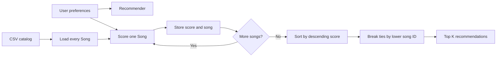

# 🎵 Music Recommender Simulation

## Project Summary

This project builds a small CLI-first music recommender that represents songs and user taste as data, scores each song with an explicit weighted recipe, and ranks the top matches.

---

## How The System Works

Real-world music recommenders estimate how likely a listener is to enjoy a song from patterns in listening history, similarity to other users and songs, and the song's metadata or audio features. Our simulation will be simpler and will prioritize transparent, content-based matching: it will compare each song directly with an explicit taste profile and rank the closest matches.

**Object features**

- `Song`: `id`, `title`, `artist`, `genre`, `mood`, `energy`, `tempo_bpm`, `valence`, `danceability`, and `acousticness`.
- `UserProfile`: `favorite_genre`, `favorite_mood`, `target_energy`, and `likes_acoustic`.

**Example taste profile**

```python
user_prefs = {
    "genre": "pop",
    "mood": "happy",
    "energy": 0.68,
    "likes_acoustic": False,
}
```

This profile represents a listener who enjoys pop, especially happy music, prefers a moderate-to-lively energy level, and does not prefer strongly acoustic arrangements. It is specific enough to distinguish quiet chill/lofi and aggressive rock from the user's taste, while the middle energy target (rather than an extreme `1.0`) allows several styles and energy levels to remain eligible. The functional dictionary keys correspond to the `UserProfile` fields: `favorite_genre`, `favorite_mood`, `target_energy`, and `likes_acoustic`.

**Scoring rule**

### Finalized Algorithm Recipe



The flow begins with the user's preferences and the complete CSV catalog. For each individual song, the recommender compares genre, mood, energy, and acousticness with the profile, calculates the total score, and stores that score with the song. After every catalog row has been evaluated, the results are sorted by descending score; a lower song ID breaks ties, and only the first `k` songs are returned.

The recommender will give every catalog song the following four-part score. Exact genre and mood matches provide meaningful bonuses, while energy and acousticness add smaller continuous or directional adjustments:

- **Genre match: +2.0 points** when `song.genre` equals `user.favorite_genre`.
- **Mood match: +1.0 point** when `song.mood` equals `user.favorite_mood`.
- **Energy similarity: up to +1.5 points**, calculated from closeness to `user.target_energy`:
  `energy_points = 1.5 × (1 - |song.energy - user.target_energy|)`
- **Acoustic preference: +0.5 points** when the acousticness direction agrees with `user.likes_acoustic`:
  +0.5 if the user likes acoustic and `song.acousticness >= 0.50`, or if the user does not like acoustic and `song.acousticness < 0.50`.

The maximum score is 5.0. The complete formula is:

`total_score = genre_points + mood_points + energy_points + acoustic_points`

Genre is weighted highest because matching the broad listening category is a strong signal. Mood is worth half a genre match, providing an important but less dominant preference. Energy contributes up to 1.5 points and rewards similar values continuously; for example, target energy `0.68` gives a `0.82`-energy song `1.5 × (1 - 0.14) = 1.29` points. Acoustic preference is a 0.5-point tie-breaker rather than a major category. These weights may be tuned later, but this is the starting recipe.

The recommender will calculate the score for every song, sort by descending `total_score`, and return the top `k` songs. If scores tie, songs may be ordered by lower `id` as a deterministic tie-breaker. For example, a pop/happy song with 0.82 energy and 0.18 acousticness can earn 2.0 genre + 1.0 mood + about 1.29 energy + 0.5 acoustic = 4.79 points, while a lofi/chill song receives only its energy and potentially its acoustic points.

The fields `tempo_bpm`, `valence`, and `danceability` remain available for future scoring and explanations, but are not part of this finalized starting recipe.

**Potential biases**

- The genre bonus is the largest match bonus, so the system may over-prioritize the favorite genre and miss strong cross-genre songs that match the user's mood or energy.
- Mood is treated as a single exact label; a song with a related mood may receive no mood points even when it could suit the user.
- The acousticness threshold is a rough binary split that may not represent preferences in the middle of the `0.0–1.0` range.
- A fixed `0.68` energy target and the catalog's limited genre coverage may make recommendations narrow or favor whichever styles are most represented.

---

## Getting Started

### Setup

1. Create a virtual environment (optional but recommended):

   ```bash
   python -m venv .venv
   source .venv/bin/activate      # Mac or Linux
   .venv\Scripts\activate         # Windows

2. Install dependencies

```bash
pip install -r requirements.txt
```

3. Run the app:

```bash
python -m src.main
```

### Running Tests

Run the starter tests with:

```bash
pytest
```

You can add more tests in `tests/test_recommender.py`.

---

## Sample Recommendation Output

```text
Loaded songs: 18

User Profile:
  Genre: pop | Mood: happy | Energy: 0.68 | Likes acoustic: False

Top 5 Recommendations:

1. Sunrise City by Neon Echo
   Score: 4.79
   Reasons: genre match (+2.0); mood match (+1.0); energy similarity (+1.29); acoustic preference (+0.5)

2. Gym Hero by Max Pulse
   Score: 3.62
   Reasons: genre match (+2.0); energy similarity (+1.12); acoustic preference (+0.5)

3. Rooftop Lights by Indigo Parade
   Score: 2.88
   Reasons: mood match (+1.0); energy similarity (+1.38); acoustic preference (+0.5)

4. Island Letters by Saint Current
   Score: 1.99
   Reasons: energy similarity (+1.49); acoustic preference (+0.5)

5. Night Drive Loop by Neon Echo
   Score: 1.90
   Reasons: energy similarity (+1.40); acoustic preference (+0.5)
```

## System Evaluation

We evaluated the recommender with three distinct listening profiles and one adversarial/conflicting edge profile. The checks use [src/main.py](/Users/rudra/Library/CloudStorage/OneDrive-FloridaAtlanticUniversity(2)/FAU%20FALL%202026%20(Sem%208)/CEN%205035%20(Software%20Engineering)/CP%20week%207%20project/ai110-module3show-musicrecommendersimulation-starter/src/main.py), [src/recommender.py](/Users/rudra/Library/CloudStorage/OneDrive-FloridaAtlanticUniversity(2)/FAU%20FALL%202026%20(Sem%208)/CEN%205035%20(Software%20Engineering)/CP%20week%207%20project/ai110-module3show-musicrecommendersimulation-starter/src/recommender.py), and [data/songs.csv](/Users/rudra/Library/CloudStorage/OneDrive-FloridaAtlanticUniversity(2)/FAU%20FALL%202026%20(Sem%208)/CEN%205035%20(Software%20Engineering)/CP%20week%207%20project/ai110-module3show-musicrecommendersimulation-starter/data/songs.csv).

### High-Energy Pop

```text
1. Sunrise City by Neon Echo
   Score: 4.79
   Reasons: genre match (+2.0); mood match (+1.0); energy similarity (+1.29); acoustic preference (+0.5)
2. Gym Hero by Max Pulse
   Score: 3.62
   Reasons: genre match (+2.0); energy similarity (+1.12); acoustic preference (+0.5)
3. Rooftop Lights by Indigo Parade
   Score: 2.88
   Reasons: mood match (+1.0); energy similarity (+1.38); acoustic preference (+0.5)
4. Island Letters by Saint Current
   Score: 1.99
   Reasons: energy similarity (+1.49); acoustic preference (+0.5)
5. Night Drive Loop by Neon Echo
   Score: 1.90
   Reasons: energy similarity (+1.40); acoustic preference (+0.5)
```

### Chill Lofi

```text
1. Library Rain by Paper Lanterns
   Score: 4.96
   Reasons: genre match (+2.0); mood match (+1.0); energy similarity (+1.46); acoustic preference (+0.5)
2. Midnight Coding by LoRoom
   Score: 4.94
   Reasons: genre match (+2.0); mood match (+1.0); energy similarity (+1.44); acoustic preference (+0.5)
3. Focus Flow by LoRoom
   Score: 3.97
   Reasons: genre match (+2.0); energy similarity (+1.47); acoustic preference (+0.5)
4. Spacewalk Thoughts by Orbit Bloom
   Score: 2.85
   Reasons: mood match (+1.0); energy similarity (+1.35); acoustic preference (+0.5)
5. Coffee Shop Stories by Slow Stereo
   Score: 1.98
   Reasons: energy similarity (+1.48); acoustic preference (+0.5)
```

### Deep Intense Rock

```text
1. Storm Runner by Voltline
   Score: 4.98
   Reasons: genre match (+2.0); mood match (+1.0); energy similarity (+1.48); acoustic preference (+0.5)
2. Gym Hero by Max Pulse
   Score: 2.96
   Reasons: mood match (+1.0); energy similarity (+1.46); acoustic preference (+0.5)
3. Midnight Circuit by Glass Vector
   Score: 1.97
   Reasons: energy similarity (+1.47); acoustic preference (+0.5)
4. Iron Skyline by Black Canyon
   Score: 1.90
   Reasons: energy similarity (+1.40); acoustic preference (+0.5)
5. Sunrise City by Neon Echo
   Score: 1.88
   Reasons: energy similarity (+1.38); acoustic preference (+0.5)
```

### Conflicting Sad/Energetic Edge Case

```text
1. Velvet Smoke by Midnight Brass
   Score: 3.31
   Reasons: genre match (+2.0); energy similarity (+0.81); acoustic preference (+0.5)
2. Golden Highway by Westbound
   Score: 1.52
   Reasons: energy similarity (+1.02); acoustic preference (+0.5)
3. Storm Runner by Voltline
   Score: 1.48
   Reasons: energy similarity (+1.48)
4. Midnight Circuit by Glass Vector
   Score: 1.47
   Reasons: energy similarity (+1.47)
5. Gym Hero by Max Pulse
   Score: 1.46
   Reasons: energy similarity (+1.46)
```

The normal profiles produced genre- and mood-consistent leaders. The edge case was not tricked by high energy alone: genre remained the strongest signal, but no song had the requested `sad` mood, so that preference received no points. This demonstrates that exact-label mood matching can create unexpected misses when a catalog lacks the requested category.

### Weight-Shift Experiment

We temporarily reduced genre from +2.0 to +1.0 and doubled energy's maximum contribution from +1.5 to +3.0. The default High-Energy Pop profile kept Sunrise City first, but Rooftop Lights moved from third to second and Gym Hero dropped to third. For the edge profile, Velvet Smoke remained first, while Storm Runner replaced Golden Highway in the remaining order. This made the rankings more sensitive to energy similarity, but it primarily changed ordering rather than making the recommendations clearly more accurate.

### Accuracy and Surprises

For the High-Energy Pop profile, the top result, **Sunrise City**, feels consistent with my musical intuition. Pop is the exact favorite genre and happy is the exact favorite mood, and its 0.82 energy is close to the target 0.68; 0.18 acousticness also agrees with the preference for less-acoustic music. Its score of 4.79 comes directly from [src/recommender.py](/Users/rudra/Library/CloudStorage/OneDrive-FloridaAtlanticUniversity(2)/FAU%20FALL%202026%20(Sem%208)/CEN%205035%20(Software%20Engineering)/CP%20week%207%20project/ai110-module3show-musicrecommendersimulation-starter/src/recommender.py): +2.0 for the pop genre match, +1.0 for the happy mood match, +1.29 for energy similarity, and +0.5 for the acoustic preference.

The results do not show one song appearing at the top of every list: Library Rain leads the Chill Lofi profile and Storm Runner leads the Deep Intense Rock profile. This suggests the genre and mood weights are providing useful variety rather than one catalog-wide winner. The main surprise is that Blues/Energetic profile favors Velvet Smoke mainly through a genre match despite the conflicting high-energy target and missing sad mood; this is a result of exact mood matching and the small catalog. It is not evidence that the algorithm is wrong, but it shows that missing related moods can make a genre-heavy result dominate.

---

## Limitations and Risks

The recommender uses a small catalog and exact genre and mood labels. It does not consider lyrics, listening history, related tastes, or whether a mood label might describe multiple shades of emotion.

---

## Reflection

This simulation shows how explicit features and weights can turn preferences into an ordered recommendation list. It also demonstrates that fixed weights can overemphasize a strong category, miss related matches, and reflect gaps in the available catalog.
